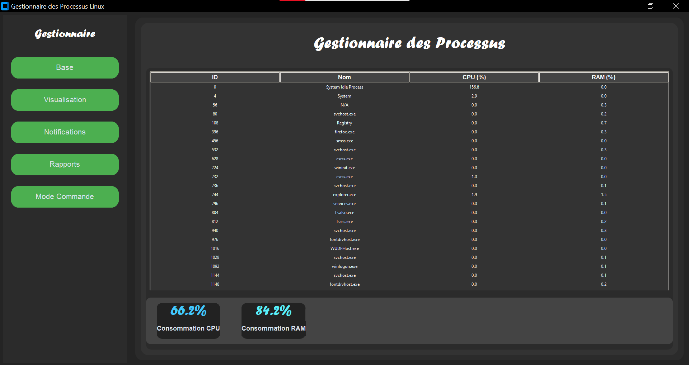
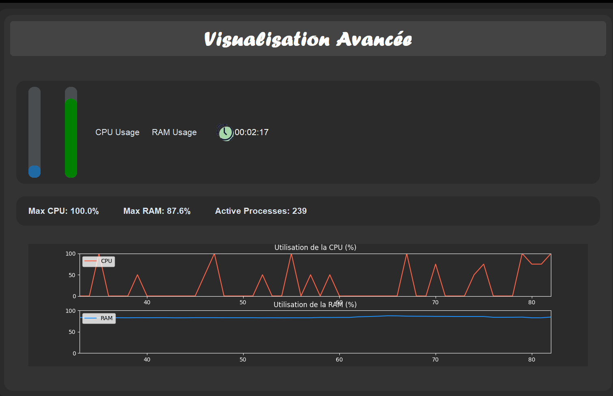
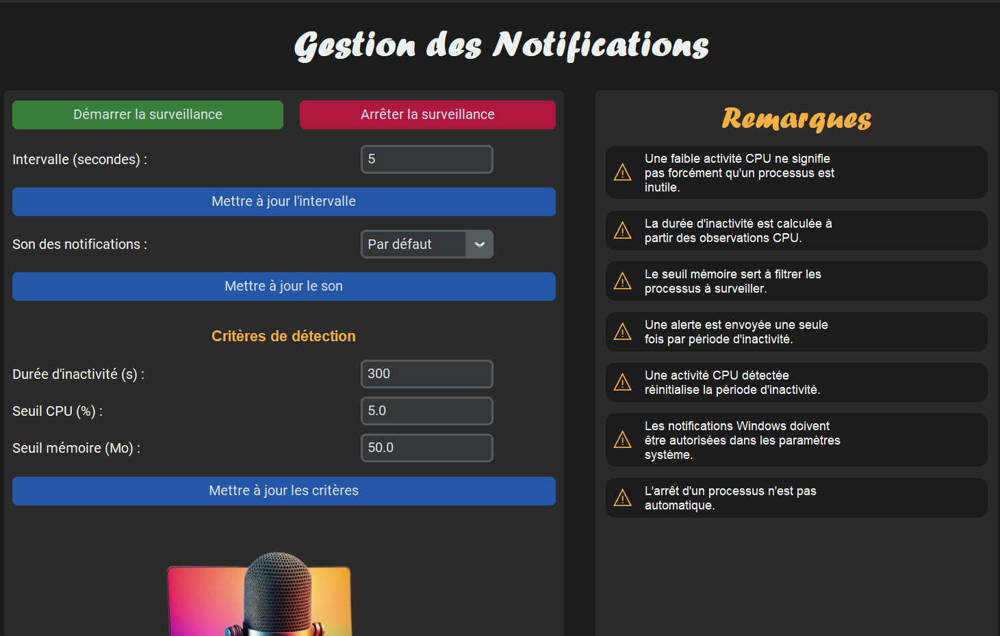
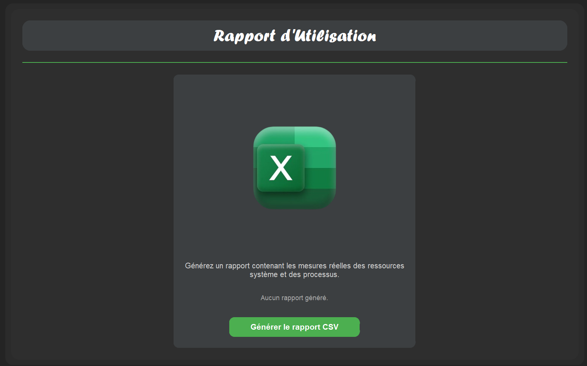
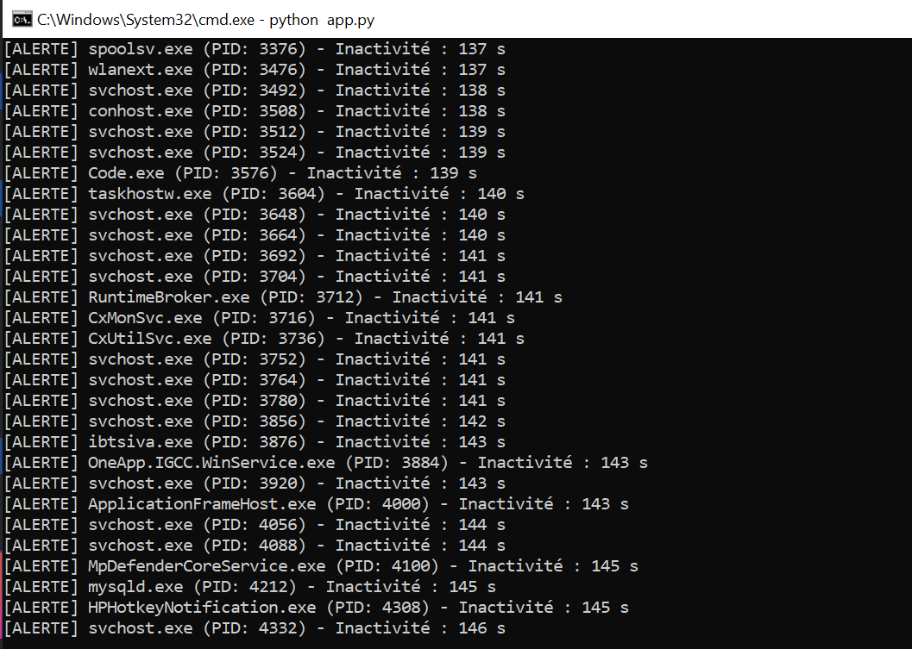
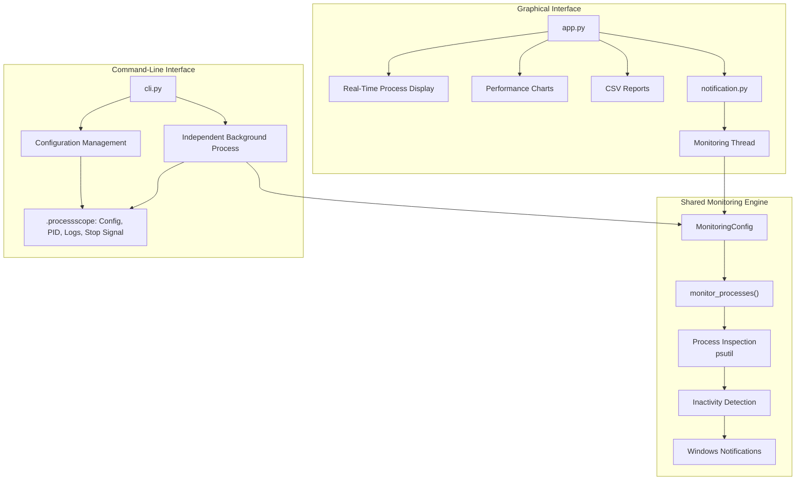
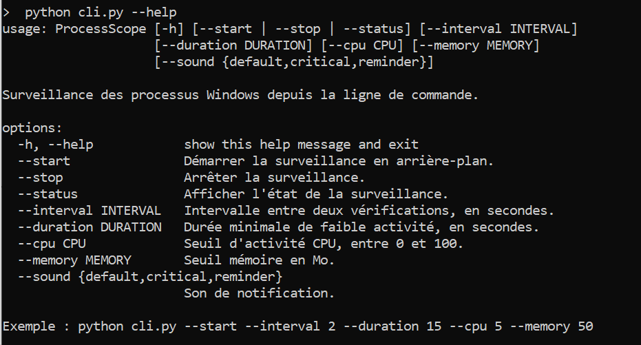
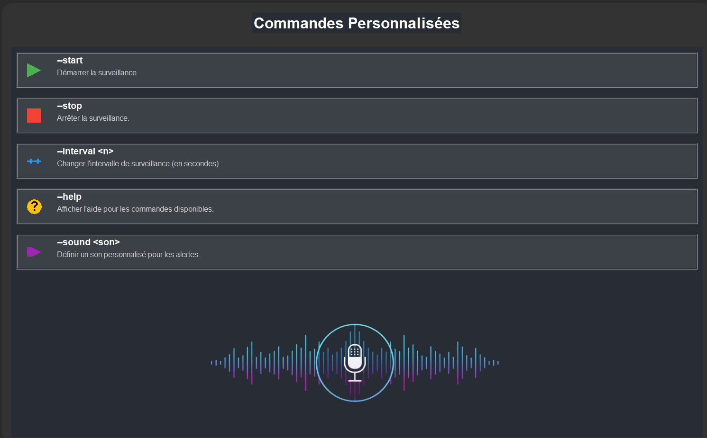

<div align="center">

<h1>ProcessScope</h1>

### Understand what is running. Monitor what matters.

A Windows process-monitoring application combining real-time system insights, configurable alerts, performance visualization, and command-line automation.


</div>

---

## 01 — Overview

**ProcessScope** is a desktop application designed to help users observe and understand the processes running on their Windows systems.

It combines process inspection, resource monitoring, performance visualization, configurable notifications, and report generation in one application.

The project provides two ways to interact with its monitoring capabilities:

- **Graphical Interface:** for visual inspection and interactive monitoring.
- **Command-Line Interface:** for background execution and automation without opening the GUI.

Both interfaces rely on a shared monitoring engine, ensuring consistent monitoring behavior.

## 02 — Features

### Real-Time Process Monitoring

Inspect running processes and observe their CPU and memory consumption through a dedicated interface.

<p align="center">
  
</p>

### Performance Visualization

Visualize CPU and memory activity through graphical representations.

<p align="center">
  
</p>

### Configurable Notifications

Configure monitoring thresholds, inactivity duration, and notification sounds.

<p align="center">
  
</p>

### CSV Reports

Generate CSV reports containing process information for external inspection and analysis.

<p align="center">
  
</p>

### Command-Line Interface

ProcessScope can run its monitoring service independently in the background, without requiring the graphical interface to remain open.

When a process meets the configured monitoring conditions, the user receives a **native Windows desktop notification directly on their PC**. These alerts are not limited to terminal messages: they are displayed through the Windows notification system and use the alert sound selected through the monitoring configuration.

The CLI supports three alert sounds: `default`, `critical`, and `reminder`.

<p align="center">
  
</p>

## 03 — System Architecture

ProcessScope separates user interaction from the underlying monitoring logic.

The graphical interface and command-line interface share the same monitoring engine, but use different execution models:

- The GUI executes monitoring in a background thread.
- The CLI launches an independent background process.

This separation allows monitoring to continue without requiring the graphical application to remain open.



### Core Components

| Component | Responsibility |
|---|---|
| `app.py` | Initializes the graphical application |
| `affichage_temps_reel.py` | Displays running processes and resource information |
| `--memory` | Memory usage threshold in MB |
| `graph.py` | Handles performance visualization |
| `notification.py` | Manages notification configuration and GUI monitoring controls |
| `rapport.py` | Generates CSV reports |
| `commande.py` | Displays command-line instructions in the GUI |
| `sidebar.py` | Provides GUI navigation |
| `styles.py` | Defines GUI styling |
| `cli.py` | Parses and executes CLI commands |
| `monitor_service.py` | Implements the shared monitoring engine and monitoring configuration |
| `paths.py` | Centralizes project and asset paths |

## 04 — Monitoring Logic

One of the central mechanisms of ProcessScope is its configurable inactivity-detection system.

The monitoring engine evaluates process activity using CPU and memory information.

A notification is triggered when the configured conditions are satisfied:

1. **CPU usage:** remains below the configured threshold.
2. **Elapsed time:** the low-CPU condition persists for the configured duration.
3. **Memory usage:** meets or exceeds the configured memory threshold.

The implementation also identifies processes using both their process ID (PID) and creation time. This helps distinguish processes when Windows reuses a PID.

The monitoring logic uses elapsed-time tracking to detect sustained low CPU activity rather than relying on a single CPU measurement.

> **Important:** Low CPU usage does not necessarily mean that a process is unnecessary. ProcessScope identifies configurable monitoring conditions; it does not automatically terminate processes.

## 05 — Technology Stack

| Technology | Purpose |
|---|---|
| Python | Core application logic |
| CustomTkinter | Graphical user interface |
| Tkinter | Desktop interface components |
| psutil | Process and system resource inspection |
| Matplotlib | Performance charts |
| Pillow | Image handling |
| winotify | Windows desktop notifications |
| argparse | CLI argument parsing |
| JSON | Monitoring configuration |
| CSV | Report export |

## 06 — Installation

### Requirements

- Windows
- Python 3
- pip

### Clone the repository

```bash
git clone https://github.com/YouSS3ra/ProcessScope.git
cd ProcessScope
```

### Create a virtual environment

```bash
python -m venv .venv
```

### Activate the environment

```bash
.venv\Scripts\activate
```

### Install dependencies

```bash
pip install customtkinter psutil matplotlib Pillow winotify
```

### Launch the graphical application

Run this command from the project root:

```bash
python src/components/app.py
```

## 07 — Command-Line Usage

ProcessScope provides a CLI for users who prefer terminal-based monitoring or want to automate the monitoring process without opening the graphical interface.

### Display help

```bash
python src/components/cli.py --help
```

<p align="center">
  
</p>

### Start monitoring

```bash
python src/components/cli.py --start
```

### Check monitoring status

```bash
python src/components/cli.py --status
```

### Stop monitoring

```bash
python src/components/cli.py --stop
```

### Configure monitoring

The CLI supports the following options:

| Argument | Description |
|---|---|
| `--interval` | Monitoring interval |
| `--duration` | Required inactivity duration |
| `--cpu` | CPU usage threshold |
| `--memory` | Memory usage threshold |
| `--sound` | Notification sound: `default`, `critical`, or `reminder` |

Example:

```bash
python src/components/cli.py --start --interval 2 --duration 15 --cpu 5 --memory 50 --sound critical
```

This command starts monitoring with:

- A 2-second monitoring interval.
- A 15-second inactivity duration.
- A CPU threshold of 5%.
- A memory threshold of 50 MB.
- The critical notification sound.

### Command Reference

<p align="center">
  
</p>

## 08 — Project Structure

```text
ProcessScope/
│
├── assets/
│   ├── icones/
│   └── images/
│
├── src/
│   └── components/
│       ├── affichage_temps_reel.py
│       ├── app.py
│       ├── cli.py
│       ├── commande.py
│       ├── graph.py
│       ├── monitor_service.py
│       ├── notification.py
│       ├── paths.py
│       ├── rapport.py
│       ├── sidebar.py
│       ├── styles.py
│       │
│       ├── com_per.py       # Previous CLI implementation
│       ├── secours.py       # Previous visualization/report implementation
│       └── test.py          # Earlier command interface experiments
│
├── Projet_SE/
│   └── main.py              # Earlier GUI prototype
│
├── .gitignore
├── requirements.txt
└── README.md
```

Runtime files and generated reports, such as `.processscope/` and `data_export.csv`, are kept locally and excluded from version control.

### Project Evolution

ProcessScope evolved through several implementation experiments before reaching its current GUI and CLI architecture. Earlier prototypes and alternative implementations have been preserved in the repository for reference, while the components documented above represent the current application structure.

## 09 — Technical Scope

- Designed for Windows process monitoring.
- Uses `psutil` to inspect process information and resource usage.
- Provides both graphical and command-line interaction.
- Supports independent background monitoring through the CLI.
- Generates CSV reports locally.
- Uses configurable monitoring conditions.
- Distinguishes process instances using PID and creation time.
- Does not automatically terminate processes.

## 10 — Project Perspective

ProcessScope brings together desktop application development, operating-system process inspection, performance visualization, notification logic, and command-line automation.

Its architecture demonstrates how different interaction layers can share the same underlying monitoring capabilities while retaining independent execution models.

<div align="center">

---

### ProcessScope

**Monitor with clarity. Understand with purpose.**

</div>
